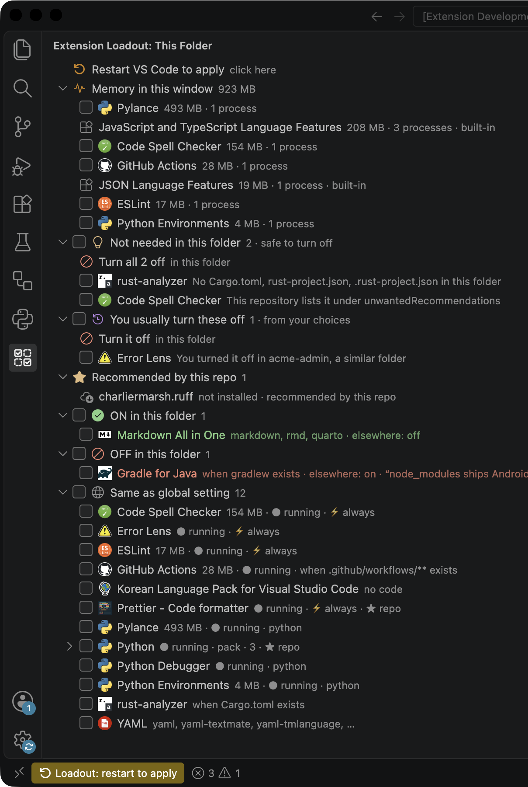
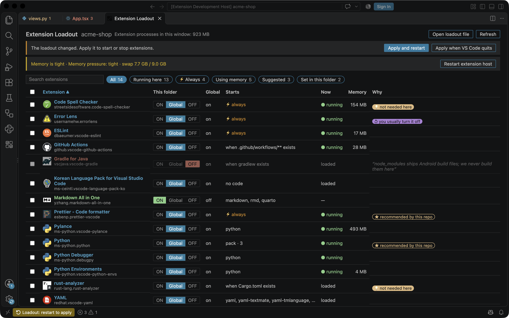
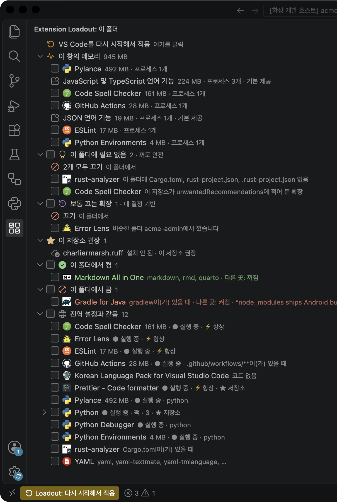

# Extension Loadout

**Equip each folder with only the extensions it needs.**

VS Code loads every enabled extension into every window. A Django repository still starts Rust and Java tooling, a Gradle daemon wakes up because `node_modules` ships Android files, and a dozen language servers sit in memory in each window you open. Extension Loadout shows what every extension costs in *this* folder, suggests the ones that are safe to turn off, and turns extensions on or off per folder with one click.



## Highlights

- **Per-folder on/off.** Every extension is *ON in this folder*, *OFF in this folder* (green ✓ / red ✕), or *same as the global setting*. The choice is saved in `.vscode/extension-loadout.json`, so you can commit it.
- **See what it costs.** *Memory in this window* lists the memory of the processes each extension started (language servers, daemons), in this window and in all windows. Heavy ones are highlighted, and a memory pressure watch tells you when the machine is running low.
- **Safe suggestions.** *Not needed in this folder* lists extensions that only start for languages or files this folder does not have, or that the repository marks as unwanted. *You usually turn these off* learns from what you turned off in folders with a similar stack. *Recommended by this repo* shows what `.vscode/extensions.json` asks for.
- **Select and act in bulk.** Tick checkboxes (a group's checkbox selects the whole group) and *Turn Off Selected*, or turn all suggestions off at once. Dependencies and extension packs are handled for you.
- **A dashboard** with every extension in one sortable, filterable table.
- **Apply your way.** One restart now, or *when you quit VS Code*, or for this folder and all its git worktrees at once. Every apply can be undone.
- **Presets** (synced with Settings Sync), patterns such as `ms-toolsai.*` with notes, multi-root workspaces and VS Code profiles.
- English and Korean UI.



## Getting started

1. Open a folder and click the **Extension Loadout** icon in the activity bar (the panel is also in the Explorer).
2. Look at *Memory in this window* and *Not needed in this folder*. Hover over a row to see why.
3. Turn extensions off or on with the buttons on each row, tick several and use **Turn Off Selected** (⊘), or click **Turn all off** on a suggestion group.
4. Click **Apply** (status bar or the panel's title) and pick *Apply and Restart VS Code* or *Apply When VS Code Quits*.

To turn something off everywhere except one project, disable it globally in the Extensions view, then turn it ON in that project's loadout.

## The loadout file

```jsonc
// .vscode/extension-loadout.json
{
  "enable": ["vscjava.vscode-gradle"],
  "disable": ["ms-toolsai.*", "!ms-toolsai.jupyter", "rust-lang.rust-analyzer"],
  "notes": {
    "ms-toolsai.*": "no notebooks in this repo"
  }
}
```

- Entries are extension IDs (`publisher.name`), patterns with `*` and `?`, or `!ID` to take something back out of a pattern in the same list.
- An exact ID beats a pattern. If an `enable` pattern and a `disable` pattern both match an extension, the panel tells you and leaves it alone.
- `notes` are shown in the panel and the dashboard.
- Changes made from the panel only rewrite the list that changed, so your patterns, notes and comments stay.
- In a **multi-root workspace** saved as `name.code-workspace`, the loadout is `name.loadout.json` next to it. Each folder's own `.vscode/extension-loadout.json` is merged in; when folders disagree, the extension stays on and the panel says so.

## Applying changes

VS Code has no API for one extension to turn another on or off, and it keeps each workspace's on/off state in memory while it runs, so a window reload does not pick up a change. Extension Loadout therefore writes that state while VS Code is not running:

- **Apply and Restart VS Code**: a small helper waits for VS Code to exit, writes the two keys VS Code uses for workspace enablement (`extensionsIdentifiers/enabled` and `…/disabled`) in this workspace's storage, and starts VS Code again, which reopens your windows. Unsaved editors are restored by hot exit, as on any quit.
- **Apply When VS Code Quits**: nothing restarts now. A tiny waiting helper (`sh` + `sqlite3` on macOS and Linux, Node elsewhere) applies the loadout the next time you quit. You can cancel it from the status bar.
- **Apply to Other Folders…**: also apply this loadout to other git worktrees of the repository (pre-selected) or other folders you have opened in VS Code, with the same single restart. Only their VS Code state changes; their files are not touched. Folders VS Code has never opened have no state to change yet.
- **Undo Last Apply** restores the previous state of every folder the last apply touched, and this folder's loadout file. **Reset Folder to Global Settings** clears all folder choices.

Global settings are never changed. The helper's log is `extension-loadout-restart.log` in your temp folder, and the *Extension Loadout* output channel records what was applied.

## Memory

- Memory is the real footprint of the processes an extension started, found by the extension's install folder in their command line (or their parent process): macOS reports memory it has compressed too, Linux adds swap, Windows uses private bytes. Plain RSS can be several times too low on a machine that is swapping.
- Memory used *inside* the shared extension host cannot be split per extension; VS Code does not expose it. **Restart Extension Host** gives all of it back for this window without restarting VS Code.
- Measured only when the panel or dashboard is shown (at most once a minute) or when you ask.
- The memory pressure watch reads the kernel's pressure level (macOS), PSI (Linux) or free memory (Windows) once a minute while Extension Loadout is active, shows the heaviest extension in the status bar when memory is tight, and notifies you once per session.

## Suggestions

*Not needed in this folder* is deliberately conservative. An extension is suggested only when all of these hold:

- it starts only for specific languages or files (`onLanguage`, `workspaceContains`, or commands you run yourself), not in every window;
- none of those files exist in the folder outside `node_modules`, virtual environments and similar;
- it does not target common formats such as JSON, Markdown or YAML;
- no extension that stays on depends on it, and you have not turned it on here yourself.

Extensions listed under `unwantedRecommendations` in `.vscode/extensions.json` are suggested too. Anything uncertain is left out, so the list can be short or empty. Extensions marked **⚡ always** start in every window and are worth reviewing yourself; they are usually the ones that cost memory.

## Commands

| Command | What it does |
| --- | --- |
| Choose Extensions for This Folder… | Checklist of every extension; checked ones run here |
| Turn Off Selected / Clear Selection | Act on the rows you ticked |
| Find Extensions This Folder Doesn't Need | Check again for safe suggestions |
| Apply Loadout… / Apply Loadout and Restart VS Code / Apply Loadout When VS Code Quits | Apply the loadout |
| Apply Loadout to Other Folders… | Also apply to worktrees and other folders |
| Undo Last Apply / Reset Folder to Global Settings | Go back |
| Open Loadout Dashboard | The table view |
| Filter and Sort… | Show all, running, ⚡ always or using memory; sort by name or memory |
| Save Loadout as Preset… / Apply Preset to This Folder… / Delete Preset… | Reuse a loadout anywhere |
| Show Extension Memory / Restart Extension Host | Memory tools |

## Settings

| Setting | Default | |
| --- | --- | --- |
| `extensionLoadout.memoryWatch.enabled` | `true` | Check memory pressure every minute while Extension Loadout is active |
| `extensionLoadout.memoryWatch.notify` | `true` | Notify once per session when memory gets tight |
| `extensionLoadout.heavyThresholdMB` | `500` | Highlight extensions whose processes use at least this much in this window |

## Staying light

Extension Loadout starts at launch only in folders that have a loadout file; elsewhere it waits until you open its panel or run a command. The installed-extension list is read in the background only while the panel is visible and cached until extensions change, suggestions are computed once per window with a single file search for the candidates' patterns, and the dashboard holds no state while hidden.

## Limits

- Needs VS Code 1.101 or newer (it uses the SQLite module built into VS Code's Node.js).
- Applying always means VS Code quits once, now or later. There is no way to change extension enablement of a running window from an extension.
- In a multi-root workspace VS Code keeps one on/off state for the whole workspace, so folder files are merged rather than applied per folder.
- Built-in extensions are listed only in *Memory in this window*, for information.
- If another extension depends on one you turn off, VS Code may keep it running; the panel marks that with a warning.

## 한국어

VS Code 표시 언어가 한국어이면(한국어 언어 팩) 패널, 대시보드, 명령, 알림이 모두 한국어로 나옵니다.



## Development

```sh
npm install
npm run test:unit   # rules, catalog, suggestions, processes, helpers, l10n completeness
npm run test:e2e    # drives isolated VS Code windows through apply → restart → apply on quit
                    # → other folders → undo, plus multi-root workspaces and profiles
npm run test:e2e:open   # macOS: installed .vsix, relaunch with `open -n -a`, window restore
node scripts/screenshots.mjs [--ko]   # README screenshots (macOS)
```

The end-to-end tests use their own `--user-data-dir` and `--extensions-dir` under `.vscode-test/`, so your own VS Code setup is never touched. CI runs the unit tests and both end-to-end suites on macOS, Ubuntu and Windows.
